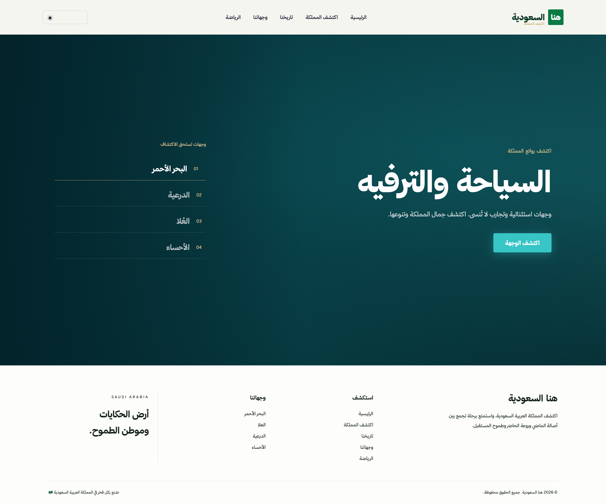
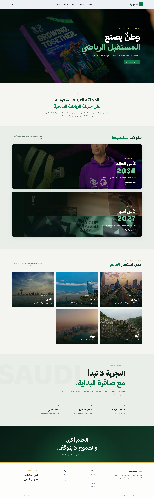
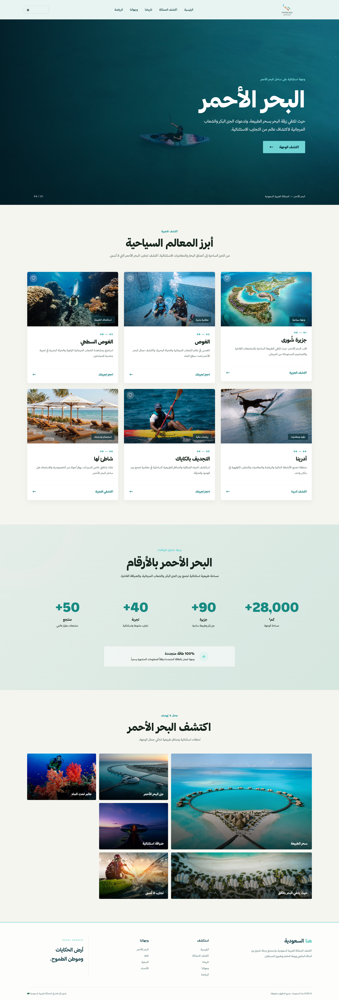

<div align="center">

# 🇸🇦 هنا السعودية | HERE SAUDI

### رحلة تفاعلية لاكتشاف المملكة العربية السعودية

استكشف تاريخ المملكة، ووجهاتها، وثقافتها، وإنجازاتها الرياضية، وتجاربها السياحية في تجربة رقمية واحدة.

<br>


</div>

---

## ✨ نبذة عن المشروع

**هنا السعودية** موقع إلكتروني تفاعلي يهدف إلى تقديم تجربة رقمية للتعرّف على المملكة العربية السعودية، من خلال صفحات ومحتوى يستعرض تاريخها ومناطقها ووجهاتها السياحية والثقافية والرياضية.

يركّز المشروع على تصميم بصري حديث، وتجربة استخدام سلسة، ودعم الوضعين الليلي والنهاري، مع استخدام الصور ومقاطع الفيديو لإثراء تجربة التصفح.

## 🚀 المميزات

- واجهة عربية بتصميم حديث.
- دعم الوضع الليلي والوضع النهاري.
- صفحات مستقلة لمواضيع ومناطق مختلفة في المملكة.
- استخدام الصور ومقاطع الفيديو في عرض المحتوى.
- شريط تنقّل وتذييل موحّدان بين الصفحات.
- تصميم متجاوب مع أحجام الشاشات المختلفة.

## 🗺️ صفحات الموقع

| الصفحة | المسار |
|---|---|
| الرئيسية | `/` |
| المملكة وتاريخها | `/kingdom/` |
| السياحة والترفيه | `/tourism-entertainment/` |
| الرياضة | `/sports/` |
| الثقافة والمعرفة | `/culture/` |
| البحر الأحمر | `/red-sea/` |
| العلا | `/alula/` |
| الدرعية | `/diriyah/` |
| الأحساء | `/al-ahsa/` |

## 🖼️ لقطات من الموقع

تُعرض لقطات الوضع الليلي أو النهاري تلقائيًا بحسب تفضيل المظهر في جهازك أو متصفحك عند عرض README على GitHub.

> ملاحظة: هذا التبديل خاص بصور README، وليس زرًا لتغيير وضع الموقع نفسه.

### الصفحة الرئيسية

<picture>
  <source media="(prefers-color-scheme: dark)" srcset="SaudiProject/SaudiApp/static/SaudiApp/images/screenshot/light/home.png">
  
</picture>

### المملكة وتاريخها

<picture>
  <source media="(prefers-color-scheme: dark)" srcset="SaudiProject/SaudiApp/static/SaudiApp/images/screenshot/dark/kingdom.png">
  
</picture>

### السياحة والترفيه

<picture>
  <source media="(prefers-color-scheme: dark)" srcset="SaudiProject/SaudiApp/static/SaudiApp/images/screenshot/light/tourism.png">
  
</picture>

### الرياضة

<picture>
  <source media="(prefers-color-scheme: dark)" srcset="SaudiProject/SaudiApp/static/SaudiApp/images/screenshot/light/sports.png">
  
</picture>

### الثقافة والمعرفة

<picture>
  <source media="(prefers-color-scheme: dark)" srcset="SaudiProject/SaudiApp/static/SaudiApp/images/screenshot/light/culture.png">
  
</picture>

### البحر الأحمر

<picture>
  <source media="(prefers-color-scheme: dark)" srcset="SaudiProject/SaudiApp/static/SaudiApp/images/screenshot/light/red-sea.png">
  
</picture>

### العلا

<picture>
  <source media="(prefers-color-scheme: dark)" srcset="SaudiProject/SaudiApp/static/SaudiApp/images/screenshot/light/alula.png">
  
</picture>

### الدرعية

<picture>
  <source media="(prefers-color-scheme: dark)" srcset="SaudiProject/SaudiApp/static/SaudiApp/images/screenshot/light/diriyah.png">
  
</picture>

### الأحساء

<picture>
  <source media="(prefers-color-scheme: dark)" srcset="SaudiProject/SaudiApp/static/SaudiApp/images/screenshot/light/al-ahsa.png">
  
</picture>

## 🛠️ التقنيات المستخدمة

- **Python** — لغة البرمجة الأساسية.
- **Django** — إطار عمل تطوير تطبيقات الويب.
- **HTML5** — بناء صفحات الموقع.
- **CSS3** — التنسيق والتصميم ودعم المظاهر.
- **JavaScript** — التفاعلات وسلوك الواجهة.
- **SQLite** — قاعدة البيانات المستخدمة في بيئة التطوير.

## 📁 هيكل المشروع

```text
UNIT-PROJECT-2/
├── venv/
├── .gitignore
└── SaudiProject/
    ├── manage.py
    ├── SaudiProject/
    │   ├── settings.py
    │   ├── urls.py
    │   ├── asgi.py
    │   └── wsgi.py
    └── SaudiApp/
        ├── migrations/
        ├── templates/
        │   └── SaudiApp/
        ├── static/
        │   └── SaudiApp/
        │       ├── css/
        │       ├── js/
        │       ├── images/
        │       │   └── screenshot/
        │       │       ├── dark/
        │       │       └── light/
        │       └── videos/
        ├── views.py
        ├── urls.py
        └── ...
```

## ⚙️ تشغيل المشروع محليًا

### 1. استنساخ المستودع

```bash
git clone https://github.com/iimustafa/UNIT-PROJECT-2.git
cd UNIT-PROJECT-2
```

### 2. إنشاء وتفعيل البيئة الافتراضية

```bash
python3 -m venv venv
source venv/bin/activate
```

### 3. تثبيت Django

```bash
pip install django
```

إذا أضفت ملف `requirements.txt` إلى المشروع، استخدم بدلًا من ذلك:

```bash
pip install -r requirements.txt
```

### 4. الانتقال إلى مجلد Django

```bash
cd SaudiProject
```

### 5. تطبيق ترحيلات قاعدة البيانات

```bash
python manage.py migrate
```

### 6. تشغيل الخادم المحلي

```bash
python manage.py runserver
```

ثم افتح:

```text
http://127.0.0.1:8000/
```

## 🎬 ملفات الفيديو

قد يحتوي المشروع محليًا على مقاطع فيديو كبيرة الحجم. تم استثناؤها من Git لتقليل حجم المستودع وتسريع عملية الرفع والاستنساخ.

لذلك، لن تظهر ملفات الفيديو في نسخة المشروع التي يتم استنساخها من GitHub، ويجب توفيرها محليًا داخل مجلد الفيديوهات عند الحاجة إلى تشغيل المحتوى المرئي.

## 👨‍💻 المطوّر

**Mustafa Al-Ali**

GitHub: [@iimustafa](https://github.com/iimustafa)

---

<div align="center">

صُنع بكل فخر في المملكة العربية السعودية 🇸🇦

**هنا السعودية | HERE SAUDI**

</div>
